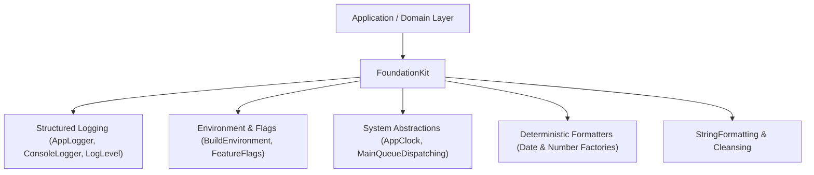

# FoundationKit

Core architectural primitives, testable system abstractions, and deterministic formatting utilities for multi-app Swift ecosystems.


---

## Architecture



`FoundationKit` is designed as a zero-dependency baseline layer that unlocks 100% deterministic testability and clean architecture:

1. **System Abstractions for Testability**:
   - `AppClock`: Protocol abstracting `now -> Date`. `SystemClock` wraps the actual system time, while `FixedClock` provides predictable dates during unit tests.
   - `MainQueueDispatching`: Protocol abstracting main-thread execution. Prevents unit tests from hanging or experiencing asynchronous race conditions.
2. **Environment & Feature Flagging**:
   - `BuildEnvironment`: Explicit `.debug`, `.staging`, and `.release` cases.
   - `FeatureFlags`: Key-value toggle store for canary deployments and A/B test toggles.
   - `AppConfiguration`: Unified state combining environment and feature flags.
3. **Thread-Safe, Deterministic Formatters**:
   - `DateFormatterFactory` and `NumberFormatterFactory`: Produce pre-configured formatters with fixed Gregorian calendars, POSIX locales, and UTC/GMT offsets to prevent localized date parsing regressions.
4. **Structured Logging**:
   - `AppLogger` & `ConsoleLogger`: Structured subsystem/category logging with configurable timestamp formatting and log levels (`.debug`, `.info`, `.warning`, `.error`).

---

## Use Cases

- **Eliminating Singleton Anti-Patterns**: Inject `AppClock` and `MainQueueDispatching` into ViewModels and Services instead of hardcoding `Date()` or `DispatchQueue.main`.
- **Reproducible Date & Number Formatting**: Guarantee that financial figures, timestamps, and API strings format identically regardless of the user device's locale or calendar preferences.
- **Dynamic Feature Toggling**: Enable or disable features at runtime across debug, staging, and production environments.
- **Cross-Kit Core Dependency**: Serves as the stable foundational dependency for `LocalisationKit` and higher-level domain packages.

---

## Practical Code Examples

### 1. Testable Clock and Main Queue Dispatching

```swift
import Foundation
import FoundationKit

final class AuctionViewModel: ObservableObject {
    @Published var timeRemaining: String = ""
    private let clock: AppClock
    private let dispatcher: MainQueueDispatching
    private let expiryDate: Date

    init(
        expiryDate: Date,
        clock: AppClock = SystemClock(),
        dispatcher: MainQueueDispatching = MainQueueDispatcher()
    ) {
        self.expiryDate = expiryDate
        self.clock = clock
        self.dispatcher = dispatcher
        updateTime()
    }

    func updateTime() {
        let now = clock.now
        let remaining = max(0, expiryDate.timeIntervalSince(now))
        dispatcher.dispatch {
            self.timeRemaining = "\(Int(remaining))s remaining"
        }
    }
}
```

### 2. Deterministic Date Formatting

```swift
import Foundation
import FoundationKit

// Make a deterministic date formatter using POSIX locale and UTC
let isoFormatter = DateFormatterFactory.make(
    dateFormat: "yyyy-MM-dd'T'HH:mm:ss'Z'",
    locale: Locale(identifier: "en_US_POSIX"),
    timeZone: TimeZone(secondsFromGMT: 0),
    calendar: Calendar(identifier: .gregorian)
)

let dateString = isoFormatter.string(from: Date(timeIntervalSince1970: 0))
// Output: "1970-01-01T00:00:00Z"
```

### 3. Feature Flags & App Configuration

```swift
import FoundationKit

let flags = FeatureFlags(flags: [
    "enableNewPlaybackEngine": true,
    "showExperimentalRecommendations": false
])

let config = AppConfiguration(
    environment: .staging,
    featureFlags: flags
)

if config.featureFlags["enableNewPlaybackEngine"] {
    print("Launching next-gen player in \(config.environment.rawValue) mode")
}
```

### 4. Structured Console Logging

```swift
import FoundationKit

let logger = ConsoleLogger(
    subsystem: "com.anurag.mytv",
    category: "Playback"
)

logger.info("Initializing AVPlayer with HLS stream", file: #file, function: #function, line: #line)
logger.error("Player item failed to load stream manifest")
```

---

## Release Version Controlling

`FoundationKit` follows strict [Semantic Versioning (SemVer 2.0.0)](https://semver.org/spec/v2.0.0.html):

| Release Level | Criteria | Example Tag |
| :--- | :--- | :--- |
| **MAJOR** (`X.0.0`) | Breaking public API changes or abstraction removals | `v1.0.0` |
| **MINOR** (`0.X.0`) | New utility types, new factories, additional abstractions | `v0.2.0` |
| **PATCH** (`0.1.X`) | Bug fixes, internal performance improvements | `v0.1.1` |

- **Release Documentation**: Documented in [CHANGELOG.md](CHANGELOG.md).
- **Tagging Format**: All tags use standard SemVer prefixed with `v` (e.g. `v0.1.1`).
- **Verification Script**: Verified locally and in CI with `bash Scripts/verify-release-version.sh`.
- **SPM Integration**:
  ```swift
  .package(url: "https://github.com/Anurag-Chourasia/FoundationKit.git", from: "0.1.0")
  ```

---

## Quality & CI Verification

1. **SwiftLint Gate**:
   - Enforces the organization's pinned 24-rule policy (`.swiftlint.yml`, SwiftLint 0.65.1).
   - Strict mode enabled (`--strict`, warnings treated as errors).
   - Run locally: `bash Scripts/lint.sh`.
2. **Build & Test Gate**:
   - Builds host and simulator targets with complete strict concurrency (`-strict-concurrency=complete`) and `-warnings-as-errors`.
   - Comprehensive unit test suite covering formatters, dispatchers, clocks, and flags.
   - iOS Simulator product verification via `xcodebuild`.
