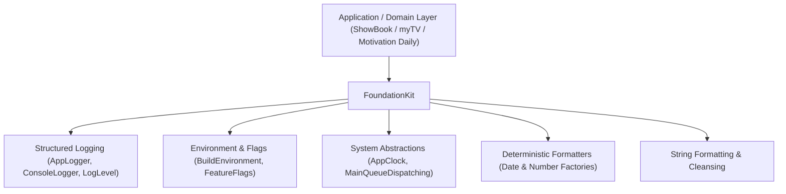
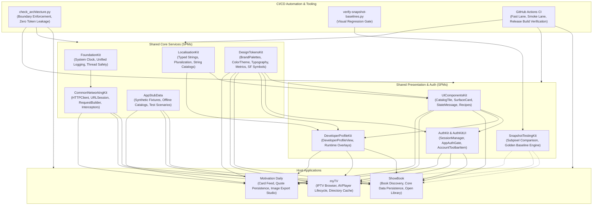

# FoundationKit

Core architectural primitives, testable system abstractions, thread-safe dispatching, and deterministic formatting utilities for multi-app Swift ecosystems.


-success)


---

## 1. Executive Summary & Purpose

`FoundationKit` provides foundational abstractions over system services that frequently impede testability when used directly. It abstracts system clocks, thread dispatching, feature flags, and formatted strings to guarantee 100% deterministic unit testing and eliminate singleton anti-patterns across the codebase.

### Key Engineering Objectives:
- **Testable System Abstractions**: Replaces direct calls to `Date()` or `DispatchQueue.main` with injectible protocols (`AppClock`, `MainQueueDispatching`).
- **Deterministic Formatting**: Pre-configured factories (`DateFormatterFactory`, `NumberFormatterFactory`) enforce Gregorian calendars, POSIX locales, and GMT/UTC offsets, preventing subtle bugs caused by user device calendar overrides.
- **Structured Logging & Diagnostics**: Standardized logging abstractions (`AppLogger`) with granular log levels and subsystem categories.
- **Environment & Feature Flagging**: Explicit build environment models (`.debug`, `.staging`, `.release`) and runtime feature toggling (`FeatureFlags`).

---

## 2. Architecture & Design Principles



### Architectural Tenets:
1. **Zero External Dependencies**: Implemented strictly using Apple's `Foundation` framework.
2. **Swift 6 Strict Concurrency**: All models and protocols conform to `Sendable`. Time and dispatch abstractions are thread-safe and non-blocking.
3. **No Singleton Enforcement**: Default implementations are provided for convenience (`SystemClock`), but all consuming services must accept protocol abstractions via constructor injection.

---

## 3. Dependency Graph & Consumer Matrix

| Direction | Package / Project | Responsibility |
|---|---|---|
| **Upstream Dependencies** | *None* | Zero third-party or internal dependencies. Pure Apple `Foundation`. |
| **Downstream Consumers** | **CommonNetworkingKit** | Consumes logging abstractions and time tracking utilities. |
| | **ShowBook** | Injects `AppClock` and `DateFormatterFactory` into Core Data bookmark and metadata engines. |
| | **myTV** | Injects time providers into stream timeout monitors and catalog refresh schedulers. |
| | **Motivation Daily** | Injects clocks into daily quote rotation and session randomization logic. |

---

## 4. API Contracts & Practical Code Examples

### 1. Eliminating System Time Coupling with `AppClock`
```swift
import Foundation
import FoundationKit

final class ExpiringSessionService {
    private let clock: AppClock
    private let timeoutInterval: TimeInterval

    // Injected clock: defaults to SystemClock in production, FixedClock in tests
    init(clock: AppClock = SystemClock(), timeoutInterval: TimeInterval = 3600) {
        self.clock = clock
        self.timeoutInterval = timeoutInterval
    }

    func isSessionExpired(startedAt: Date) -> Bool {
        return clock.now.timeIntervalSince(startedAt) > timeoutInterval
    }
}
```

### 2. Deterministic Date Formatting
```swift
import Foundation
import FoundationKit

struct TransactionReceipt {
    static func formatTimestamp(_ date: Date) -> String {
        // Enforces POSIX locale and UTC calendar to prevent regional parsing bugs
        let formatter = DateFormatterFactory.iso8601()
        return formatter.string(from: date)
    }
}
```

### 3. Feature Flagging and Environment Configuration
```swift
import FoundationKit

let config = AppConfiguration(
    environment: .staging,
    featureFlags: [
        "enable_new_feed_ui": true,
        "enable_biometrics": false
    ]
)

if config.isFeatureEnabled("enable_new_feed_ui") {
    // Render modern card feed
}
```

---

## 5. Verification & Testing

The package includes tests verifying mock clocks, main queue dispatching under asynchronous conditions, and formatter isolation across thread boundaries.

```sh
# Run tests locally
swift test

# Build for macOS and iOS simulator
swift build
```

---

## 6. End-to-End Ecosystem Connectivity



---

## 7. Canonical Notion Dashboards & Governance Links

- [iOS Portfolio — Engineering Tickets Dashboard](https://app.notion.com/p/c20d7f4b133b44499c8ac0b4d5f6249e?pvs=204)
- [iOS Portfolio — Master Document](https://app.notion.com/p/40ffa5f855b98192ad2ede66a5d36fe7)
- [Architecture Boundary Validator (`check_architecture.py`)](file:///Users/anuragchourasia/Desktop/Projects/UIComponentsKit/Scripts/check_architecture.py)
- [Release & Gate Policy Documentation (`Docs/MASTER.md`)](file:///Users/anuragchourasia/Desktop/Projects/Docs/MASTER.md)
